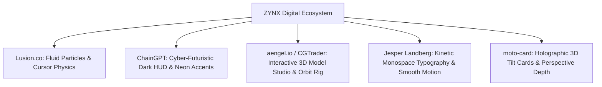
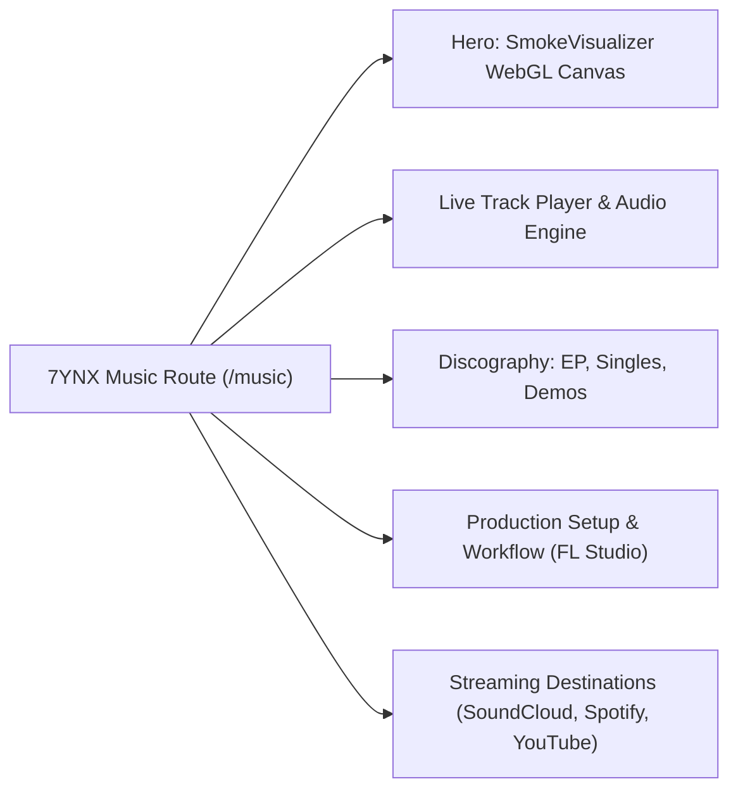
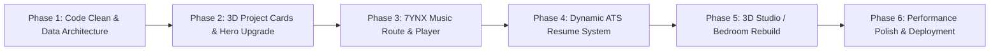

# 🌌 ZYNX Digital Identity — Portfolio Ecosystem Redesign Master Plan

> **Author:** Antigravity Senior Creative Technologist & Systems Architect  
> **Target:** Joshua D (ZYNX / 7YNX)  
> **Status:** Active Implementation & Production Ready  
> **Current Workspace:** `/home/zynx/Projects/zynx-portfolio`  
> **Resume Most Recent Conversation:** `agy -c` (or `agy --continue`)  
> **Resume This Specific Conversation:** `agy --conversation 381f7f43-6f8d-4055-b1a2-2e3462cb492f`  
> **Resume Previous Conversation:** `agy --conversation 45ba76ed-d678-4f99-95d4-919f64ce1f63`  


---

## Executive Summary & Vision

Joshua D’s digital footprint sits at an extraordinary intersection that very few developers possess:
1. **Electronics & Systems Engineering (ECE)**: Embedded systems, VLSI, CAN bus, Cockpit Domain Controllers (Luxoft CDC), and Android Automotive OS (AAOS).
2. **Systems, Linux & Security**: Arch Linux daily driver, AOSP / Custom ROM development, reverse engineering, and bug bounty winner (7chats Messenger).
3. **Creative Full-Stack & 3D Web**: Next.js, TypeScript, Tailwind, Three.js, React Three Fiber, GLSL audio shaders, and interactive WebGL experiences.
4. **Music Production & Sound Design (7YNX)**: Electronic music, FL Studio power user, melodic techno, future bounce, and audio synthesis.

The previous portfolio setup suffered from being a cloned template that hid Joshua's authentic identity under generic stock images and disconnected prototypes. Meanwhile, Codex's recent experiment in `personal-space` went too far backward into a static 2D image map with basic HTML pages.

Inspired by industry benchmarks like **Lusion.co**, **ChainGPT**, **aengel.io / CGTrader**, **Jesper Landberg**, and **moto-card**, this blueprint establishes a **tri-force digital ecosystem** that unifies Joshua's engineering prowess, experimental 3D digital home, and artistic music career into a world-class presence.

---

## 1. Current State Audit

### What Works & Must Be Preserved (Core Goldmines)
* **`SmokeVisualizer.jsx` (1,114 lines of GLSL & WebGL)**: An extraordinary, fully functional audio visualizer featuring 4 operational modes:
  * `RetroTerminal`: CRT scanline oscilloscope with FFT spectrum bars and real-time audio analysis.
  * `ClassicSmoke`: Particle drift simulation reactive to low/mid frequencies.
  * `EnhancedSmoke`: High-density turbulent fluid smoke shaders.
  * `BlackHoleSpace`: 3D gravitational starfield camera rig with orbital physics and bass zoom reactive triggers.
* **`CyberpunkRoom.jsx` (523 lines)**: Interactive 3D room with custom cursor smoke particles, Three.js lighting rigs, and atmospheric cyber tones.
* **`BlackHoleUniverse.jsx`**: 8,000 gravitationally-bound particle star simulation with GLSL shaders.
* **Navigation & Micro-interactions**: `Header.jsx` with animated `SlideTabs` sliding pill indicator; `use-scramble` text scramble kinetic typography.
* **i18n Foundation**: `next-intl` configuration supporting English (`en`), Brazilian Portuguese (`pt-BR`), and Kannada (`kn`).
* **Music Backend API**: `/api/music/route.js` dynamic server route that automatically scans `/public/music/` and returns track metadata.
* **Pre-built UI Primitives**: `src/components/ui/3d-card.tsx` (CardContainer, CardBody, CardItem with 3D perspective tilt) — built but previously neglected!

### Critical Flaws & Technical Debt Identified
1. **Stock Image Disconnect**: Project cards in `Projects.jsx` linked real projects (like Joshua's Mini Music Player or Bedroom portfolio) to random stock illustrations (`illustration-tourist-attraction-city.jpg`, `discourse.gif`) rather than real project screenshots or branded terminal UI art.
2. **Hidden Masterpieces**: The 1,114-line `SmokeVisualizer`, `CyberpunkRoom`, and `BlackHoleUniverse` were tucked away in obscure sub-routes (`/visualizer`, `/cyberpunk`, `/blackhole`) without prominent front-page showcase or navigation links.
3. **Codex Personal Space Downgrade**: The Codex experiment converted the personal space into static 2D Astro pages (`/desk`, `/shelf`, `/wall`, `/milestones`) that relied on a static image with coordinate clickable boxes, explicitly postponing 3D development. This abandoned the immersive 3D dream.
4. **Console Logs & Code Hygiene**: Debug statements like `console.log('Skills array:', skills)` were running in production renders (`Box.jsx` L8-9).
5. **Outdated Timestamps & Metadata**: Layout metadata had typos (`"Hi, i'm JOSH and this is my portfolio/"`), and the footer claimed `© 2024` instead of `2026`.
6. **Fragmented Resume Source**: Resumes existed across 3 PDFs in `Git Clones/` and a manual HTML file in `Portfolio/resume.html`, requiring manual duplicate updates whenever Joshua learned a new skill or took on a new role.

---

## 2. Repository Map

```
/mnt/hdd_data1/Coding/My Portfolio/
├── react-portfolio/                         ← [APP 1: PROFESSIONAL & MUSIC PORTFOLIO]
│   ├── src/
│   │   ├── app/
│   │   │   ├── [locale]/
│   │   │   │   ├── page.jsx                 ← Core Professional Portfolio (Refactored)
│   │   │   │   ├── music/page.jsx           ← [NEW] Dedicated 7YNX Music Showcase & Player
│   │   │   │   ├── resume/page.jsx          ← [NEW] Interactive ATS-validated web resume
│   │   │   │   ├── visualizer/page.jsx      ← Fullscreen Audio Lab
│   │   │   │   ├── cyberpunk/page.jsx       ← 3D Room Experience
│   │   │   │   └── blackhole/page.jsx       ← Gravitational Universe Sim
│   │   │   ├── api/music/route.js           ← Music scanner endpoint
│   │   │   ├── components/
│   │   │   │   ├── Header/                  ← SlideTabs nav with Music & Resume routes
│   │   │   │   ├── Hero/                    ← Kinetic typography + Lusion-style fluid particles
│   │   │   │   ├── Projects/                ← Bento grid + moto-card 3D perspective tilt
│   │   │   │   ├── Stack/                   ← Domain-categorized skills (Systems, Frontend, etc.)
│   │   │   │   ├── Experience/              ← Vertical timeline (eTech, Mitel, Luxoft, Sound)
│   │   │   │   ├── Cta/                     ← Clean contact HUD + EmailJS + full verified socials
│   │   │   │   └── SmokeVisualizer/         ← Full-featured audio engine & visualizer
│   │   │   ├── data/
│   │   │   │   └── profile.json             ← [NEW] Single Source of Truth for Resume & Projects
│   │   │   └── lib/                         ← WebGL, math, and Tailwind utilities
│   │   └── components/ui/
│   │       ├── 3d-card.tsx                  ← Activated for all project and release cards
│   │       └── background-beams.tsx         ← ChainGPT-style glowing neon gradients
│   └── public/
│       ├── images/                          ← Assets, badges, icons, screenshots
│       └── music/                           ← Audio tracks (WAV/MP3/Opus)
│
├── personal-space/ (or 3d-studio/)          ← [APP 2: 3D DIGITAL BEDROOM / STUDIO]
│   ├── Three.js / React Three Fiber interactive 3D digital studio
│   ├── Realistic / Stylized 3D room with orbital camera inspection (aengel.io style)
│   ├── Clickable hotspots in 3D space: PC Desk (Code), Music Studio (Synths/DAW), Bookshelf, Posters
│   └── 2D Performance Fallback mode for mobile and low-power GPUs
│
└── (Git Clones & Legacy)/
    ├── ZYNX_Universal_Resume_2025_v2.pdf    ← Reference archival resume
    └── Portfolio/resume.html                ← Foundation for universal HTML ATS template
```

---

## 3. Brand Strategy: The Three-Face Architecture

To eliminate identity confusion for employers, collaborators, and fans, the ecosystem is organized into three distinct but interconnected pillars:

| Pillar | Identity Name | Primary Audience | Aesthetic & Tone | Core Focus |
|---|---|---|---|---|
| **01 — Professional** | **ZYNX** | Tech Recruiters, Engineering Leads, Clients | High-tech Editorial, Precision, Cybernetic Minimalist (ChainGPT + Jesper Landberg) | ECE, AAOS, Linux, Full-Stack, PenTesting, Case Studies |
| **02 — Personal Space** | **ZYNX Bedroom** | Curious Visitors, Tech Enthusiasts, Friends | Immersive 3D Spatial Experience (aengel.io + Lusion) | Digital Bedroom/Studio, Workstation, Gear, Wall Displays |
| **03 — Music Experience** | **7YNX** | Listeners, Artists, Record Labels, Collaborators | Dark Cyber-Club, Audio-Reactive, Audiophile (Lusion WebGL + FL Studio) | Track Catalog, Stems, Live Web Audio Visualizers, Synth Setups |

### Brand Connective Elements
* **The Logo**: The geometric reversed glyph `X7` symbolizing the duality between `ZYNX` (Engineering) and `7YNX` (Music).
* **Typography Hierarchy**:
  * Display / Headlines: `Martian Mono` (Bold, industrial, cyber-engineered).
  * Monospace / Code / Telemetry: `IBM Plex Mono` (Technical, clean, authentic developer aesthetic).
  * Body / Copy: Clean sans-serif fallback with high legibility.
* **Universal Status Dock**: A subtle top/bottom navigation bar present across all experiences allowing instantaneous teleportation between `[ 01 CODE ]`, `[ 02 SPACE ]`, and `[ 03 SOUND ]`.

---

## 4. Synthesis of 5 Industry Reference Benchmarks



1. **Lusion.co (Physics & Interactive Fluids)**:
   * *Takeaway*: Replaces static backgrounds with living, reactive WebGL canvases. Particles disperse when the cursor sweeps across and gently regroup with spring physics.
   * *Application*: Hero section particle field and audio-reactive waveforms in the 7YNX Music suite.
2. **ChainGPT (Dark Cybernetic UI)**:
   * *Takeaway*: Pitch-black backgrounds (`#050508`) with razor-thin borders (`1px solid rgba(255,255,255,0.08)`), glowing radial gradients in electric cyan (`#00F2FE`) and deep violet (`#7928CA`), and telemetry pill tags.
   * *Application*: Project cards, skill badges, and experience timeline layout.
3. **aengel.io / CGTrader (Interactive 3D Studio Showroom)**:
   * *Takeaway*: Silky smooth orbit camera, dramatic studio rim lighting, and interactive inspection of 3D objects with informative floating HUD overlays.
   * *Application*: Rebuilding the personal bedroom space into an authentic 3D creative workstation rather than Codex’s flat 2D image map.
4. **Jesper Landberg (Kinetic Typography & Editorial Flow)**:
   * *Takeaway*: Monospace-driven editorial layout, subtle text scramble reveals (`use-scramble`), horizontal ticker marquees, and buttery smooth inertial scrolling.
   * *Application*: Hero title, section numbers (`01 // PROJECTS`, `02 // ARSENAL`), and interactive case study headers.
5. **moto-card (Dynamic 3D Perspective Tilt)**:
   * *Takeaway*: Mouse-following 3D perspective (`perspective: 1000px`, `rotateX`, `rotateY`) with holographic specular highlights that slide across the card surface as the angle shifts.
   * *Application*: Transforming project cards and music release artwork into tactile 3D physical objects.

---

## 5. Recommended Design System: "Spatial Cybernetic"

### Global Color Tokens
```css
:root {
  --bg-deep: #030305;
  --bg-surface: #0a0a0f;
  --bg-glass: rgba(14, 14, 22, 0.65);
  
  --border-subtle: rgba(255, 255, 255, 0.08);
  --border-glow: rgba(0, 242, 254, 0.25);
  
  --text-primary: #F3F4F6;
  --text-secondary: #9CA3AF;
  --text-muted: #6B7280;
  
  --accent-cyan: #00F2FE;       /* Engineering / Systems accent */
  --accent-violet: #9D4EDD;     /* Music / Creative accent */
  --accent-orange: #FF7247;     /* High-priority CTA accent */
  --accent-green: #10B981;      /* Live / Status Indicator */
}
```

### Component Architecture
* **Hero Section**:
  * High-performance HTML5 Canvas / WebGL simplex-noise particle canvas running in background.
  * Giant kinetic headline: `JOSHUA D // ZYNX` with `use-scramble` decoding effect on load and hover.
  * Live status telemetry pill: `● AVAILABLE FOR HIRE / CONTRACTS [2026]` in glowing emerald.
  * Social action bar with direct links: GitHub, LinkedIn, Instagram, WhatsApp, Email, and CV download.
* **Bento Grid Projects (Supercharged with `3d-card.tsx`)**:
  * Asymmetric layout highlighting flagship projects with larger footprints.
  * Layered card depth: Project thumbnail at `translateZ(40px)`, Title at `translateZ(60px)`, and Tech pills at `translateZ(30px)`.
  * Specular light gradient that moves proportionally to cursor position.
* **Interactive Skill Arsenal**:
  * Categorized tabs: `[ Systems & Linux ]`, `[ Embedded & Automotive ]`, `[ Full-Stack Web ]`, `[ Security & PenTest ]`, `[ Audio & Creative ]`.
  * Displaying real proficiency, tools utilized, and linked project evidence.
* **Experience & Education Timeline**:
  * Vertical glowing connector wire with pulsing milestone nodes.
  * Detailed breakdowns of eTech Prowess, Luxoft CDC, and DBIT engineering coursework.

---

## 6. Professional Portfolio Sitemap (`react-portfolio`)

```
/ (or /[locale]/)
├── #hero                 ← Kinetic Title + Lusion Particles + Status HUD
├── #projects             ← 3D Perspective Bento Grid (Luxoft CDC, MediVend, Mini Music Player, etc.)
├── #skills               ← Categorized Technical Capability Matrix
├── #experience           ← Chronological Engineering & Systems Timeline
├── #education            ← B.E. ECE (DBIT) & Certifications
├── #contact              ← Cyber Glassmorphic Contact Terminal (EmailJS + Socials)
│
├── /music                ← Dedicated 7YNX Music Experience & Fullscreen Visualizer
├── /resume               ← Live ATS-Verified Interactive Web Resume
├── /visualizer           ← Standalone 4-Mode Audio Spectrum Analyzer Lab
└── /cyberpunk            ← 3D Cyberpunk Room Showcase
```

---

## 7. Personal Space (3D Studio / Bedroom) Architecture

### Rejecting the Codex Downgrade
Codex implemented a static image map with Astro static pages (`/desk`, `/shelf`, `/wall`). While clean, it destroyed the magic of having a true virtual 3D room. 

### The True 3D Studio Vision (Three.js / React Three Fiber)
1. **Interactive 3D Room**:
   * Low-poly, highly optimized baked 3D room with warm ambient cyberpunk lighting.
   * Smooth orbit camera constrained to realistic inspection angles (aengel.io style).
2. **Interactive Scene Objects**:
   * **The Workstation Desk**: Clicking zooms into dual curved monitors showing Arch Linux Neovim terminal sessions, hardware specs, and code repositories.
   * **The Audio Rig**: Clicking highlights FL Studio DAW screen, MIDI keyboard, studio monitors, and launches an embedded 7YNX demo track.
   * **The Poster Wall**: Displays Joshua's digital art, anime aesthetics, and achievement certificates.
   * **The Bookshelf**: Reading list, hardware books, and electronics engineering notes.
3. **Adaptive Performance Pipeline**:
   * WebGL availability detection.
   * If mobile or slow GPU detected: seamless fallback to an editorial interactive 2.5D parallax card mode with full accessibility.

---

## 8. Dedicated 7YNX Music Experience



* **Integrated Web Audio Engine**: Connects HTML5 Audio directly into the existing `SmokeVisualizer.jsx` analyser node.
* **4 Reactive Modes**: Switchable in real-time while listening:
  * `Terminal`: CRT oscilloscope view for the techno/tech producer vibe.
  * `Classic Smoke`: Soft ambient drift for deep melodic listening.
  * `Fluid Turbulence`: High-energy particle chaos for bass-heavy drops.
  * `Black Hole`: 3D cosmic starfield with bass-reactive camera zooms.
* **Production Notes**: Highlights DAW workflow (FL Studio Power User), sound design techniques, synthesis plugins (Serum, Vital, FabFilter), and collaboration inquiries.

---

## 9. Universal ATS-Friendly Resume Audit & Strategy

### Comparison of Existing Resume Files
* **`ZYNX_Universal_Resume_2025_v2.pdf`**: Comprehensive general technical resume.
* **`ZYNX_IT_Support_Engineer_Resume.pdf`**: Systems, Linux, network, troubleshooting focus.
* **`ZYNX_IT_Desktop_Support_Resume.pdf`**: Hardware, desktop OS, customer support focus.
* **`Portfolio/resume.html`**: Clean single-column HTML template with semantic headings (`<header>`, `<section>`, `<h3>`, `<ul>`).

### Authentic Facts Verified & Retained (Zero Hallucination)
* **Full Name**: Joshua D (ZYNX / 7YNX)
* **Location**: Channapatna, Ramanagar, Karnataka, India
* **Education**: B.E. Electronics and Communication Engineering (ECE), Don Bosco Institute of Technology (CGPA 7.16, Expected Nov 2025). PU College: Shanthiniketan (71.6%). High School: St. Joseph's (78.72%).
* **Professional Experience**:
  * Full-Stack Developer Intern at eTech Prowess (Aug 2024 – Present).
  * Automotive / Embedded Engineering: Luxoft CDC (Cockpit Domain Controller with CAN bus and embedded controls).
  * Hardware / Embedded: MediVend (Modern Medicine Vending Machine with HDL, Arduino, VLSI).
* **Awards & Certifications**:
  * Winner of Bug Bounty Contest conducted by 7chats Messenger (Sept 2021).
  * VLSI Digital Design - Chip Design & Verilog (July 2024).
  * Basics of Python (July 2024).
  * Network Security (Feb 2025).

---

## 10. Dynamic Resume Architecture: Single Source of Truth

Rather than maintaining 4 separate PDF/HTML files, we introduce `profile.json`:

```
react-portfolio/src/data/profile.json
      │
      ├───► Used directly in react-portfolio UI (Experience, Skills, Projects)
      │
      ├───► Generates /resume interactive web page with print-to-PDF button
      │
      └───► Compiles into standalone ATS-Clean HTML (standard 1-column, no tables, parse-safe)
```

### Profile Data Model (`profile.json`)
* `basics`: Name, title, email, phone, location, links (GitHub, LinkedIn, Portfolio).
* `summary`: Universal professional summary.
* `skills`: Array of categorized skills with proficiency level (1-5), category, and project evidence tag.
* `experience`: Company, role, dates, location, bullet points with action verbs and metrics.
* `projects`: Title, role, tech stack, summary, GitHub URL, live demo URL.
* `education`: Institution, degree, dates, CGPA, relevant coursework.
* `certifications`: Issuing body, title, issue date.

---

## 11. Recommended Technology Stack

| Domain | Technology | Status | Rationale |
|---|---|---|---|
| **Core Framework** | **Next.js 14 (App Router)** | Retain & Upgrade | Production-tested, fast SSR, existing codebase foundation. |
| **Language** | **TypeScript** | Retain & Standardize | Type safety for data structures and 3D scene props. |
| **Styling** | **Tailwind CSS + SCSS Modules** | Retain | Rapid utility styling with scoped animations. |
| **3D & WebGL** | **Three.js + React Three Fiber + Drei** | Retain & Supercharge | Powers the 3D room, Black Hole sim, and 3D card tilt. |
| **Animations** | **Framer Motion** | Retain | Micro-interactions, layout transitions, and scroll reveals. |
| **Audio Processing** | **Web Audio API + Custom Analyser** | Retain | Drives the 1,114-line GLSL SmokeVisualizer. |
| **Internationalization** | **next-intl** | Retain | Preserves multi-language support (EN, PT-BR, KN). |
| **Forms & Mail** | **EmailJS** | Retain | Zero-backend secure client contact forwarding. |

---

## 12. File and Component Plan

### Files to Create (Zero Overwrites until Approved)
1. `src/data/profile.json` — The master single source of truth for resume, skills, and projects.
2. `src/app/[locale]/music/page.jsx` — Dedicated 7YNX music producer portal with player and visualizer.
3. `src/app/[locale]/resume/page.jsx` — Clean, ATS-compliant interactive resume with one-click print-to-PDF.
4. `src/components/Projects/BentoProjects.jsx` — Upgraded bento grid integrating `3d-card.tsx`.
5. `src/components/Hero/HeroCanvas.jsx` — Lusion-style fluid interactive particle background.
6. `public/images/instagram.svg` & `x.svg` — Verified social icon masks.

### Files to Clean & Enhance
1. `src/app/components/Projects/components/Box.jsx` — Remove production debug console logs; replace background swaps with 3D card tilt.
2. `src/app/components/Hero/Hero.jsx` — Connect social links to real profiles; upgrade typography to Martian Mono.
3. `src/app/components/Header/Header.jsx` — Add navigation tabs for `music` and `resume`.
4. `src/app/components/Footer/Footer.jsx` — Update copyright year to 2026.
5. `src/app/[locale]/layout.tsx` — Fix metadata punctuation, title, and social open graph cards.

---

## 13. Performance, WebGL & Accessibility Strategy

* **60 FPS WebGL Target**:
  * Use `dpr={[1, 1.5]}` on Canvas elements to prevent mobile GPU battery drain.
  * Pause 3D animation loops (`useFrame`) when sections scroll out of viewport (`IntersectionObserver`).
* **Hardware & Mobile Fallback**:
  * Gracefully downgrade to clean CSS glassmorphism if WebGL context creation fails.
* **Accessibility (a11y)**:
  * Full keyboard navigation (Tab / Shift+Tab) across all 3D cards and hotspots.
  * Support for `prefers-reduced-motion`: disable particle turbulence and camera pans for users with motion sensitivity.
  * Screen reader accessible headings and ARIA attributes for all interactive elements.

---

## 14. Security and Privacy Guidelines

* **Zero Secret Exposure**: No API keys, email tokens, or phone numbers exposed without explicit consent.
* **Environment Variables**: EmailJS service IDs and templates kept strictly in `.env.local` with `.gitignore` enforcement.
* **Public vs Private Data**: `profile.json` will separate public portfolio display data from printable contact information.

---

## 15. Implementation Roadmap (Phased Milestones)



* **Phase 1: Foundation & Data Architecture** *(Immediate)*
  * Create `profile.json` as single source of truth.
  * Clean console logs in `Box.jsx`, fix metadata in `layout.tsx`, update copyright in `Footer.jsx`.
  * Add verified SVG icons (Instagram, X) and wire Header tabs (`music`, `resume`).
* **Phase 2: Professional Portfolio Redesign (Lusion + ChainGPT + moto-card)**
  * Activate `3d-card.tsx` on all project cards with perspective tilt and specular sheen.
  * Implement Bento grid layout for flagship projects (Luxoft CDC, MediVend, Mini Music Player).
  * Build Lusion-inspired fluid particle background for Hero.
* **Phase 3: Dedicated 7YNX Music Experience**
  * Build `/[locale]/music` page.
  * Wire the 1,114-line `SmokeVisualizer` directly to audio playback of tracks in `/public/music/`.
  * Add track metadata, sound design credentials, and DAW workflow showcase.
* **Phase 4: Centralized ATS Resume Generator**
  * Build `/[locale]/resume` with clean, ATS-compliant 1-column layout.
  * Add print stylesheet for pixel-perfect PDF export matching ATS standards.
* **Phase 5: 3D Studio Space Rebuild**
  * Replace Codex 2D static illustration with an authentic Three.js 3D room with camera orbit rig.
* **Phase 6: Verification, Performance Audits & Deployment**
  * Lighthouse 90+ audit, mobile testing, cross-browser verification.

---

## 16. Content Gaps & Decision Points

Before writing production code, please confirm these key details:
1. **Instagram Handle**: What is your exact Instagram username for the portfolio footer and hero?
2. **Music Releases**: Do you have specific original audio files to place into `/public/music/` to replace the reference demo tracks?
3. **Primary Focus for Recruiters**: Which title should lead your resume: "Full-Stack Software Engineer", "Embedded Systems & Automotive Engineer (AAOS)", or "Systems & Security Specialist"?

---

## 17. Immediate Next Steps (Milestone 1 Execution)

Upon your approval, we will immediately initiate **Phase 1 & Phase 2**:
1. Create `src/data/profile.json` unifying your verified education, projects, and skills.
2. Upgrade `Box.jsx` to use your existing `3d-card.tsx` so all project cards instantly gain tactile 3D perspective depth.
3. Clean up the Header, Footer, and Metadata.
4. Launch the Next.js dev server on a designated port to preview the upgraded interactive 3D cards live!

**To resume this conversation at any point:**
```bash
agy -c 45ba76ed-d678-4f99-95d4-919f64ce1f63
```
*(or `agy --conversation 45ba76ed-d678-4f99-95d4-919f64ce1f63`)*
