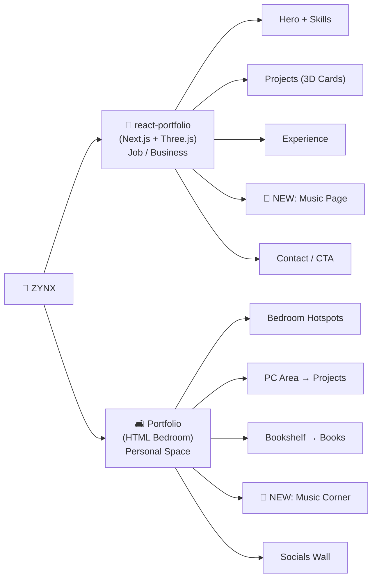
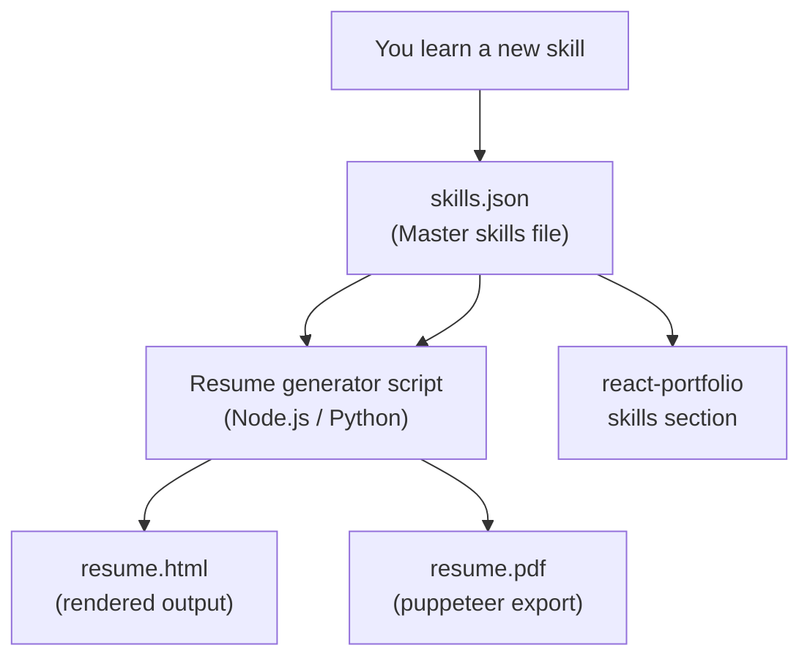
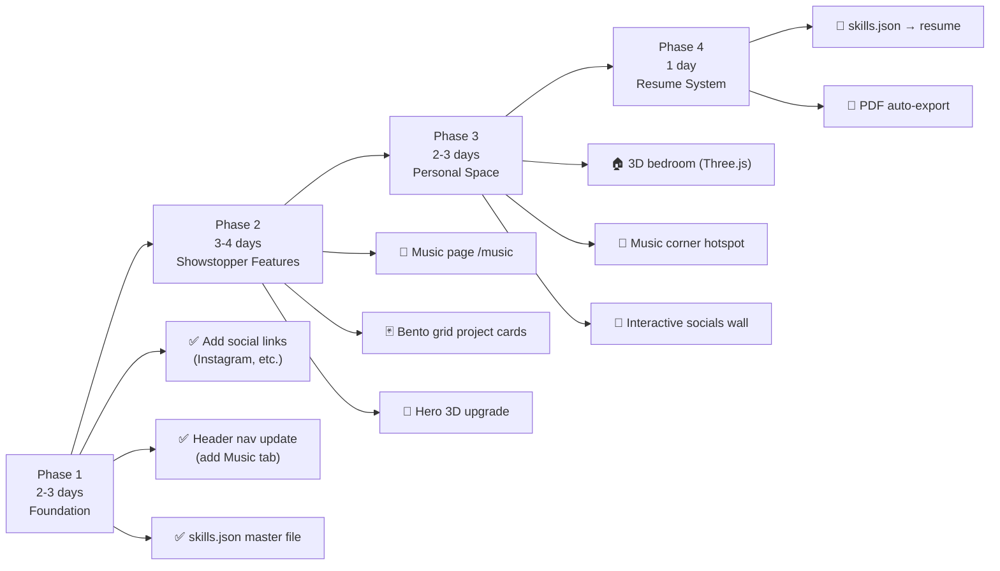

# 🚀 ZYNX Portfolio Masterplan

> Your two portfolios serve different audiences. Think of them as two sides of you:
> **react-portfolio** = Professional face | **Portfolio (Bedroom)** = Personal universe

---

## 🗺️ The Two-World Strategy



---

## 🏢 PART 1 — react-portfolio Redesign (Business/Job)

### 1.1 Hero Section — Cinematic Overhaul

**Current:** Text + scramble animation + pills
**New idea: "Holographic Identity" concept**

- Dark background with a **particle-field that reacts to cursor movement** (you already have `three.js`!)
- Your name rendered as a **3D text mesh** that slowly rotates/floats (use `@react-three/drei`'s `<Text3D>`)
- A **glassmorphism bio card** that slides in from the left
- Vertical scroll-triggered morph: hero text fades as you scroll, camera "flies into" the next section
- **Floating social pills** around your name in orbit — GitHub, LinkedIn, Instagram, WhatsApp, etc.
- Subtle **noise grain overlay** (you already have `noise.png`) + neon glow on your name

**Stack you already have:** `framer-motion`, `three.js`, `@react-three/drei`, `use-scramble`

---

### 1.2 Projects Section — 3D Card Gallery Redesign

**Current:** Flat grid of `Box` cards
**New ideas (pick one or mix):**

#### Option A — "Carousel Coverflow" (Most Dramatic)
- **3D perspective carousel** like iTunes coverflow
- Cards tilt in 3D on hover (you have `3d-card.tsx` already in `/src/components/ui/`)
- On click: card **expands into a full-screen modal** with live preview, tech stack, links
- Background of each card pulls from the project image with a **blur/frosted glass** effect

#### Option B — "Bento Grid" (Trendy & Clean)
- Asymmetric bento-style grid (some cards 1x1, some 2x1, some 1x2)
- Each card has a **unique 3D animated element** on hover (spinning tech logo, floating particles)
- Music project card features a **mini waveform animation**
- Bedroom portfolio card plays the `discourse.gif` as a looping preview

#### Option C — "Infinite Scroll Marquee" + Popup
- Projects scroll horizontally in a **3D perspective marquee**
- Click to pop up a full project showcase with screenshots + live demo embed

> [!TIP] Option B (Bento Grid) pairs best with your existing stack and the "ZYNX" personal brand vibe

---

### 1.3 🎵 NEW: Music Production Page (`/music`)

This is the **biggest addition** — a dedicated page for your music and production showcase.

**Concept: "The Studio" — Dark, cinematic, producer aesthetic**

#### Layout Sections:
1. **Hero:** Animated equalizer bars + your producer alias in glowing neon
2. **Featured Tracks:** Custom audio player cards with:
   - Waveform visualization (you already built `SmokeVisualizer` + music API!)
   - Album art displayed on a **3D vinyl record** that spins on play
   - Genre tags, BPM badge
3. **Streaming Links:** Buttons to Spotify, SoundCloud, Apple Music, YouTube Music, Instagram
4. **Video Showcase:** Embedded YouTube/Instagram Reels grid
5. **Production Credits:** Timeline of beats made, collabs, etc.

**Existing assets to leverage:**
- [`/src/app/api/music/route.js`](file:///mnt/hdd_data1/Git%20Clones/react-portfolio/src/app/api/music/route.js) — music API already exists!
- [`SmokeVisualizer.jsx`](file:///mnt/hdd_data1/Git%20Clones/react-portfolio/src/app/components/SmokeVisualizer/SmokeVisualizer.jsx) — audio visualizer already built!
- `three.js` — use for spinning vinyl records

**Navigation integration:** Add `music` tab to the existing `SlideTabs` in Header

---

### 1.4 Social Links — Full Expansion

**Current:** GitHub, LinkedIn, WhatsApp only
**Add these to Hero + Footer:**

| Platform | Where |
|----------|-------|
| Instagram | Hero pills + Footer |
| Twitter/X | Hero pills + Footer |
| SoundCloud | Footer + Music page |
| Spotify | Footer + Music page |
| YouTube | Footer + Music page |
| Linktree (optional) | Mobile footer |

---

### 1.5 Stack/Skills Section — 3D Floating Orbs

**Current:** Flat icon grid
**New idea: "Tech Solar System"**

- Skills represented as **3D orbs/planets** floating in a dark canvas
- Hover over a skill: orb glows, tooltip appears with proficiency level
- Group by category: Frontend / Backend / DevOps / Design / Music Production Software
- Use `@react-three/fiber` for the scene

---

### 1.6 Experience Section — Timeline Upgrade

- Animated **vertical timeline** with scroll-triggered reveals
- Each job card flips on hover to reveal tech stack used
- Add a **"Currently Learning"** card that updates dynamically

---

## 🛋️ PART 2 — Bedroom Portfolio (Personal Space) Upgrade

### 2.1 The 3D Bedroom Concept

**Current:** 2D image with clickable hotspots

**New Vision: Full 3D Interactive Room**

- Render the bedroom in **Three.js / React Three Fiber**
- Orbit controls so you can look around the room
- Clickable 3D objects that open panels:
  - **Monitor** → opens project showcase
  - **Bookshelf** → opens reading list
  - **Music equipment** → plays your track + opens music page
  - **Posters wall** → opens social links / art gallery
  - **Trophy shelf** → certificates and achievements
- Ambient **lofi hip-hop** plays softly in the background (toggleable)
- Day/night mode toggle that changes the room lighting

**Stack:** Three.js + React Three Fiber + Drei (`<Environment>`, `<OrbitControls>`, GLTF models from Sketchfab)

---

### 2.2 Music Corner Hotspot (NEW)

- A **corner of the bedroom** with a DAW on screen, speakers, a vinyl
- Clicking it opens a music player modal or navigates to the music page
- Animate the record spinning, speaker cones pulsing

---

### 2.3 Socials Wall / Poster Board

- Replace current flat posters with an **interactive cork board**
- Each pin is a social link with animated hover effects
- Platforms: Instagram, Twitter/X, SoundCloud, Spotify, GitHub, YouTube, LinkedIn, Discord

---

## 📄 PART 3 — Smart Auto-Updating Resume

### 3.1 The Concept: "Living Resume"

A single HTML/PDF resume that reflects your current skills — no manual editing needed.

**How it works:**



### 3.2 Implementation Plan

1. **`skills.json`** — Master data file:
```json
{
  "technical": [
    { "name": "React", "level": "Expert", "since": "2023", "category": "Frontend" },
    { "name": "Three.js", "level": "Advanced", "since": "2024", "category": "3D/Graphics" },
    { "name": "FL Studio", "level": "Intermediate", "since": "2022", "category": "Music Production" }
  ],
  "soft": ["Problem Solving", "Team Collaboration"],
  "learning": ["Rust", "WebGPU"]
}
```

2. **Auto-generate resume** from this JSON using a Node script + HTML template
3. **GitHub Action** (optional): auto-rebuild PDF on every push that updates `skills.json`
4. **Single source of truth**: same `skills.json` feeds both your resume AND the portfolio's skills section

### 3.3 Resume Template Options

| Option | Pros | Cons |
|--------|------|------|
| **Keep existing HTML template** | Already ATS-friendly | Needs minor updates |
| **New minimal HTML template** | Fresh + tailored for tech/music dual career | Small build effort |
| **Reactive HTML (CSS-only animations)** | Impressive in PDF | May break ATS parsers |

> [!IMPORTANT] For ATS compatibility, keep resume clean: no tables with images, no columns using CSS floats, no special fonts. Use a simple single-column or two-column max with semantic HTML.

> [!TIP] Add a **"Currently Learning"** section at the bottom of the resume that reads from `skills.json`'s `"learning"` array — recruiters love seeing proactive learners.

---

## 🎨 Design System — ZYNX Brand Identity

### Color Palette

| Token | Light | Dark | Use |
|-------|-------|------|-----|
| Primary | `#0A0A0A` | `#FAFAFA` | Text |
| Accent | `#FF6B35` (orange) | `#FF6B35` | CTAs, highlights |
| Music Accent | `#9D4EDD` (purple) | `#C77DFF` | Music section |
| Glow | `rgba(157,78,221,0.4)` | `rgba(157,78,221,0.6)` | 3D effects |
| Glass | `rgba(255,255,255,0.05)` | `rgba(0,0,0,0.2)` | Cards |

### Typography
- **Display:** Keep `font-martian` for the hacker vibe
- **Body:** Inter or Geist (clean, readable)
- **Music section:** Consider a condensed font like `Barlow Condensed` for producer aesthetic

### Animation Principles
- Framer Motion for 2D transitions (you already have this)
- Three.js for all 3D scenes
- Keep transitions under `400ms` — snappy, not sluggish
- Use `whileInView` for scroll-triggered animations (you're already doing this)

---

## 🛠️ Tech Stack Additions Recommended

| Package | Purpose |
|---------|---------|
| `@react-three/drei` | You have it — use `<Text3D>`, `<Float>`, `<Environment>` more |
| `lenis` | Smooth scroll library (replaces native scroll for buttery feel) |
| `wavesurfer.js` | Beautiful waveform audio player for music page |
| `gsap` + `ScrollTrigger` | You have `@gsap/react` — use ScrollTrigger for cinematic reveals |
| `puppeteer` | Auto-generate PDF from resume HTML |
| `sharp` | Optimize all your portfolio images |

---

## 📋 Build Order (Suggested Phases)



---

## ✅ Quick Wins (Do These First — 30 mins each)

1. **Add Instagram SVG** to `/public/images/` and wire it into [`Hero.jsx`](file:///mnt/hdd_data1/Git%20Clones/react-portfolio/src/app/components/Hero/Hero.jsx) social pills
2. **Add `music` to the nav tabs** in [`Header.jsx`](file:///mnt/hdd_data1/Git%20Clones/react-portfolio/src/app/components/Header/Header.jsx) SlideTabs array
3. **Create `/src/app/[locale]/music/page.jsx`** (stub) — you already have the pattern from `/blackhole/page.jsx`
4. **Add `skills.json`** to root with all your current skills (feeds resume + portfolio)
5. **Enable the existing `3d-card.tsx`** on your project `Box` component — it's already in your codebase unused!

---

> [!NOTE] You already have an impressively deep stack: Three.js, React Three Fiber, Framer Motion, GSAP, Smoke Visualizer, BlackHole simulation, CyberpunkRoom, a music API, aurora/wavy backgrounds — most of the heavy lifting is already done. The goal now is to **surface and connect** these pieces into a cohesive, branded experience.
